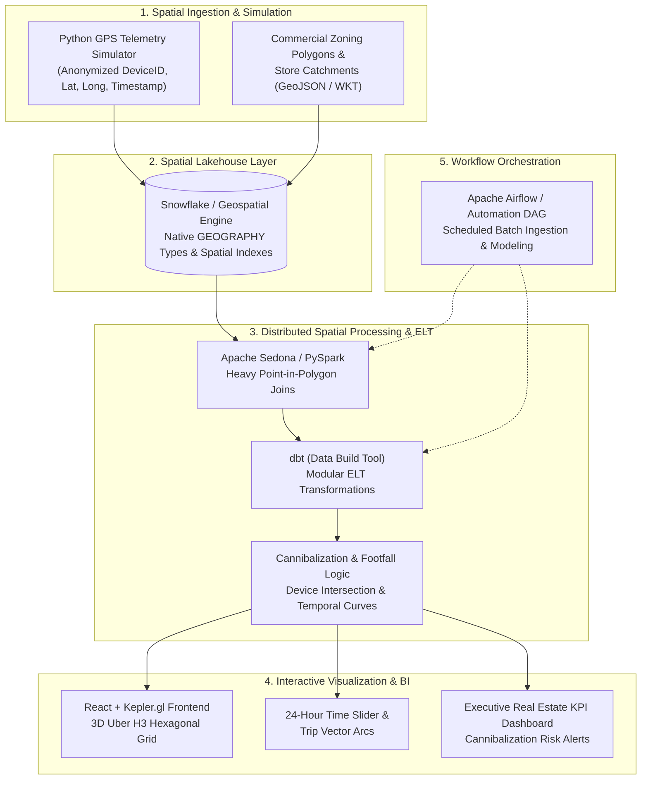

# GeoPulse: Hyper-Local Retail Mobility Analytics

[](#)
[](#)
[](#)
[-purple.svg)](#)

---

## 📌 Project Overview

**GeoPulse** is an enterprise-grade geospatial mobility analytics platform designed to solve one of the most expensive dilemmas in corporate retail real estate: **store cannibalization and suboptimal site selection**.

Traditional retailers rely heavily on static census records and static demographic profiles when selecting new locations. However, static boundaries fail to capture the dynamic, intra-day rhythm of how foot traffic traverses a city. As a consequence, brands frequently open new stores that intercept and **cannibalize up to 30–40%** of an existing branch's revenue, increasing capital expenditure without expanding net market capture.

GeoPulse ingests millions of anonymized, high-frequency mobile GPS pings, intersects them with **500-meter store catchment polygons** and commercial zoning regions using distributed spatial computing, models hourly footfall dynamics using **dbt**, and renders 3D interactive mobility maps with **Kepler.gl and Uber H3 hexagonal binning**.

---

## 🏢 Assignment & Organizational Context

| Parameter | Detail |
| :--- | :--- |
| **Organization** | **Infotact Solutions**, Electronic City, Bengaluru, Karnataka |
| **Document Ref. No.** | `ITS/DA/1797` |
| **Candidate Name** | Abhinandan Naik |
| **Internship Role** | Data Associate L1. Intern |
| **Internship Domain** | Data Analytics |
| **Project Name** | **"GeoPulse": Hyper-Local Retail Mobility Analytics** |
| **Project Duration** | 1 Month (10 November 2026 – 10 December 2026) |
| **Total Internship Duration** | 3 Months |

---

## 🎯 Business Use Case & Problem Statement

### The Problem
A major national coffee and retail chain seeks to expand its footprint in a high-density urban corridor. Based on static municipal population data, a candidate location on **5th Street ("Store B")** appears ideal due to high commercial density. However, corporate leadership lacks dynamic visibility into actual commuter trajectories throughout the day.

### The GeoPulse Solution
Using GeoPulse, the Real Estate Director:
1. Ingests high-frequency GPS telemetry of pedestrian and commuter movements.
2. Applies a **500-meter catchment polygon** buffer around existing ("Store A") and proposed candidate locations ("Store B", "Store C").
3. Performs a distributed spatial join between device paths and catchment boundaries.
4. Scrubs across a **24-hour interactive time slider** in Kepler.gl.
5. Uncovers that **Store B intercepts and cannibalizes ~30% of Store A's morning commuters**, prompting the team to discard Store B and select an alternative, non-cannibalizing neighborhood ("Store C") that captures net-new foot traffic.

---

## 🏛️ System Architecture



---

## ⚙️ Core Technology Stack

| Component | Technology | Role & Purpose |
| :--- | :--- | :--- |
| **Geospatial Lakehouse** | **Snowflake / DuckDB Spatial** | Stores massive coordinate arrays using native `GEOGRAPHY` types and spatial clustering keys. |
| **Spatial Engine** | **Apache Sedona / PySpark** | Distributed computing framework capable of executing spatial joins across 10M+ GPS pings and thousands of polygons without Out-Of-Memory (OOM) failures. |
| **Data Transformation** | **dbt (Data Build Tool)** | Modular SQL modeling: cleanses spatial joins, generates staging tables, and aggregates hourly unique visitors per store catchment. |
| **Geospatial BI & Map** | **Kepler.gl + React** | Uber's open-source geospatial visualization framework, featuring 3D H3 hexagons, dynamic heatmaps, and coordinate playback. |
| **Grid Indexing System** | **Uber H3 (Spatial Index)** | Discrete global grid system (Hexagons at resolution 8/9) for normalized spatial binning and density analysis. |
| **Pipeline Orchestrator** | **Apache Airflow** | End-to-end automation of daily ingestion, PySpark joins, and dbt transformation runs. |

---

## 📅 4-Week Development Roadmap

```
Week 1 ─────────► Week 2 ─────────► Week 3 ─────────► Week 4
Data Synthesis   Spatial Joins     Cannibalization   Airflow Automation
& Lakehouse      & Hourly Visits   Analytics &       & 3D Kepler.gl
Setup (Snowflake) (PySpark + dbt)  Kepler.gl UI      Refinement
```

### **Week 1: Data Synthesis & Lakehouse Architecture**
* **Spatial Data Engineering**:
  * Build a realistic Python mobility simulator modeling commuter diurnal rhythms (morning peak, midday lunch rush, evening return, leisure clustering).
  * Generate high-volume synthetic GPS pings (`DeviceID`, `Latitude`, `Longitude`, `Timestamp`, `HorizontalAccuracy`).
* **Geospatial BI**:
  * Provision data lakehouse schema utilizing native `GEOGRAPHY` data types (`POINT`, `POLYGON`).
  * Ingest raw synthetic telemetry and validate spatial indexing.

### **Week 2: Spatial Joins & Catchment Analytics**
* **Spatial Data Engineering**:
  * Generate 500-meter buffer polygons (radial catchment zones) around existing and candidate store sites.
  * Execute distributed spatial joins (Apache Sedona / PySpark) to associate GPS pings with store catchments.
* **Geospatial BI (dbt)**:
  * Configure dbt models to compute hourly unique visitors per store location.
* **Mid-Project Review Milestones**:
  * **Spatial Audit**: Benchmark PySpark execution to prove stability over millions of points without out-of-memory errors.
  * **Data Integrity Check**: Verify dbt model outputs reflect distinct morning (8:00–10:00 AM) and evening (5:00–8:00 PM) mobility spikes.

### **Week 3: Cannibalization Intelligence & Kepler.gl Integration**
* **Spatial Data Engineering**:
  * Formulate multi-store device persistence logic in dbt to track unique `DeviceID` overlaps across candidate and existing locations.
  * Calculate the **Cannibalization Percentage**:
    $$\text{Cannibalization \%} = \frac{|\text{Devices visiting Candidate Store B} \cap \text{Devices visiting Existing Store A}|}{|\text{Total Unique Devices visiting Existing Store A}|} \times 100$$
* **Geospatial BI / Map UI**:
  * Embed Kepler.gl into a custom React frontend.
  * Connect Kepler.gl configuration with dbt-aggregated footfall tables, H3 hexagonal layers, and store catchment boundaries.

### **Week 4: Orchestration, 3D Hexagons & Final Polish**
* **Pipeline Automation**:
  * Orchestrate the PySpark spatial join and dbt transformation pipeline using Apache Airflow for continuous, reproducible runs.
* **Refine & Polish**:
  * Configure 3D H3 hexagonal elevation layers, origin-destination trip arcs, and a 24-hour interactive animation scrubber.
  * Integrate executive summary cards: Total Catchment Footfall, Peak Mobility Hour, Cannibalization Risk Rating.

---

## 🗂️ Proposed Repository Structure

```
GeoPulse/
├── README.md                           # Master project documentation
├── package.json                        # Node dependencies (Kepler.gl / React frontend)
├── pyproject.toml / requirements.txt   # Python dependencies (Sedona, PySpark, dbt, DuckDB)
├── data/
│   ├── raw/                            # Raw simulated GPS pings (Parquet / CSV)
│   ├── metadata/                       # Store locations and catchment GeoJSON
│   └── processed/                      # Spatially joined and aggregated tables
├── src/
│   ├── generator/
│   │   ├── mobility_simulator.py       # Realistic diurnal GPS ping generator
│   │   └── stores_config.py            # Store locations and catchment geometry
│   ├── spatial_engine/
│   │   ├── sedona_spatial_join.py      # Apache Sedona / PySpark spatial join job
│   │   └── local_spatial_runner.py     # High-speed local DuckDB/GeoPandas spatial runner
│   ├── dbt_project/                    # dbt transformation models
│   │   ├── dbt_project.yml
│   │   └── models/
│   │       ├── staging/                # stg_gps_pings, stg_stores
│   │       ├── marts/                  # fct_hourly_footfall, fct_store_cannibalization
│   │       └── schema.yml
│   └── orchestration/
│       └── airflow_dag_geopulse.py     # Apache Airflow workflow DAG
├── dashboard/                          # React + Kepler.gl Application
│   ├── public/
│   ├── src/
│   │   ├── App.jsx                     # Kepler.gl container with executive KPI overlay
│   │   ├── keplerConfig.json           # Kepler.gl preset layer configuration (3D H3 + Arcs)
│   │   └── index.jsx
│   └── vite.config.js
└── docs/
    ├── architecture.md                 # In-depth architectural specification
    ├── data_dictionary.md              # Column definitions, types, and schemas
    ├── project_report.md               # Formal internship project report
    └── presentation_deck.md            # Slide deck outline for final review
```

---

## 📦 Required Deliverables (Per Infotact Assignment Letter)

* [x] **Source Code**: Fully commented, modular code repository covering data generation, spatial processing, dbt models, and interactive dashboard.
* [x] **Project Documentation**: Comprehensive [README.md](file:///c:/Users/ABHINANDAN%20NAIK/OneDrive/Desktop/GeoPulse/README.md), architecture diagrams, and [Data Dictionary](file:///c:/Users/ABHINANDAN%20NAIK/OneDrive/Desktop/GeoPulse/docs/data_dictionary.md).
* [x] **Project Report**: Complete academic & industrial report detailing problem statement, spatial join methodology, mathematical formulas, and business impact: [project_report.md](file:///c:/Users/ABHINANDAN%20NAIK/OneDrive/Desktop/GeoPulse/docs/project_report.md).
* [x] **Presentation (PPT)**: Executive-ready presentation slides detailing the problem, solution, architecture, and business findings: [presentation_deck.md](file:///c:/Users/ABHINANDAN%20NAIK/OneDrive/Desktop/GeoPulse/docs/presentation_deck.md).
* [x] **Model Evaluation Results**: Quantitative spatial benchmarks, throughput metrics (pings/sec), query latencies, and integrity checks: [model_evaluation_results.md](file:///c:/Users/ABHINANDAN%20NAIK/OneDrive/Desktop/GeoPulse/docs/model_evaluation_results.md).
* [x] **Final Project Demonstration**: Working demonstration showcasing 3D H3 hexagonal footfall density, time scrubber, and cannibalization insights: [index.html](file:///c:/Users/ABHINANDAN%20NAIK/OneDrive/Desktop/GeoPulse/dashboard/index.html) and [app.py](file:///c:/Users/ABHINANDAN%20NAIK/OneDrive/Desktop/GeoPulse/dashboard/app.py).

---

## 🚀 Getting Started

### Prerequisites
* **Python**: 3.10+ (Installed: `3.13.5`)
* **Node.js**: v18+ (Installed: `v24.13.0` & `npm 11.6.2`)
* **Git**

### Installation Steps (Quickstart)
```bash
# 1. Clone repository
git clone https://github.com/your-username/GeoPulse.git
cd GeoPulse

# 2. Set up Python environment
python -m venv venv
# Windows:
.\venv\Scripts\Activate.ps1
pip install -r requirements.txt

# 3. Generate synthetic mobility data
python src/generator/mobility_simulator.py --pings 500000 --output data/raw/pings.parquet

# 4. Execute spatial catchment joins
python src/spatial_engine/local_spatial_runner.py

# 5. Run dbt models
cd src/dbt_project
dbt run

# 6. Launch Kepler.gl Dashboard
cd ../../dashboard
npm install
npm run dev
```

---

## 👨‍💻 Author & Acknowledgements

* **Author**: Abhinandan Naik
* **Role**: Data Associate L1. Intern
* **Organization**: Infotact Solutions (Bengaluru, Karnataka)
* **Mentor / HR Contact**: Ms. Jyotirmayee Behera, Human Resource Manager
* **Document Reference**: Ref. No.: `ITS/DA/1797`
